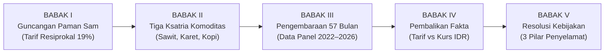
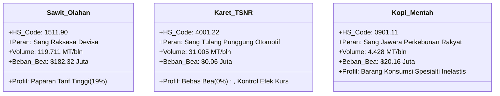
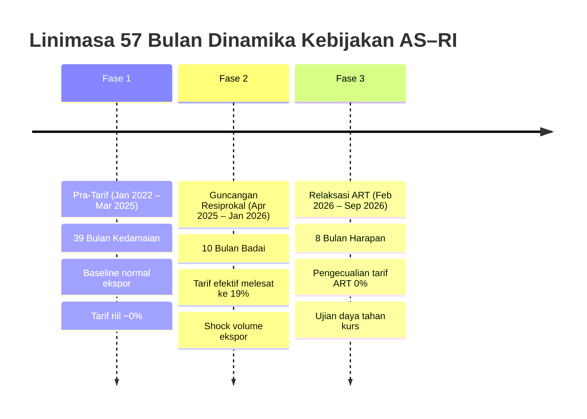
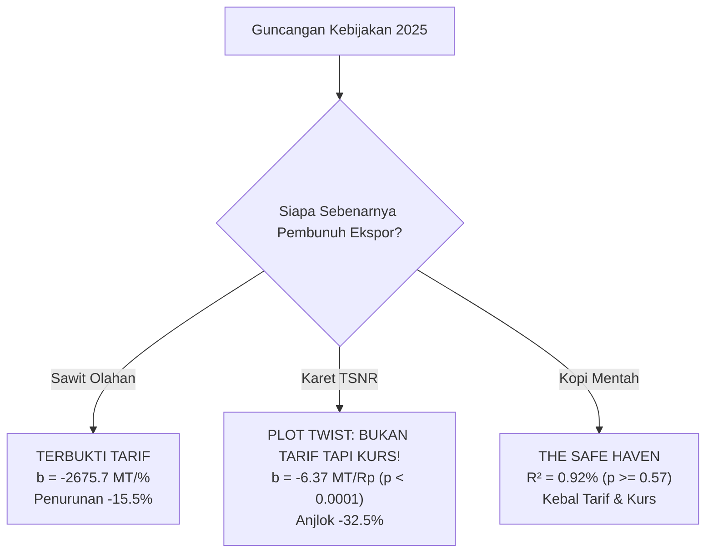
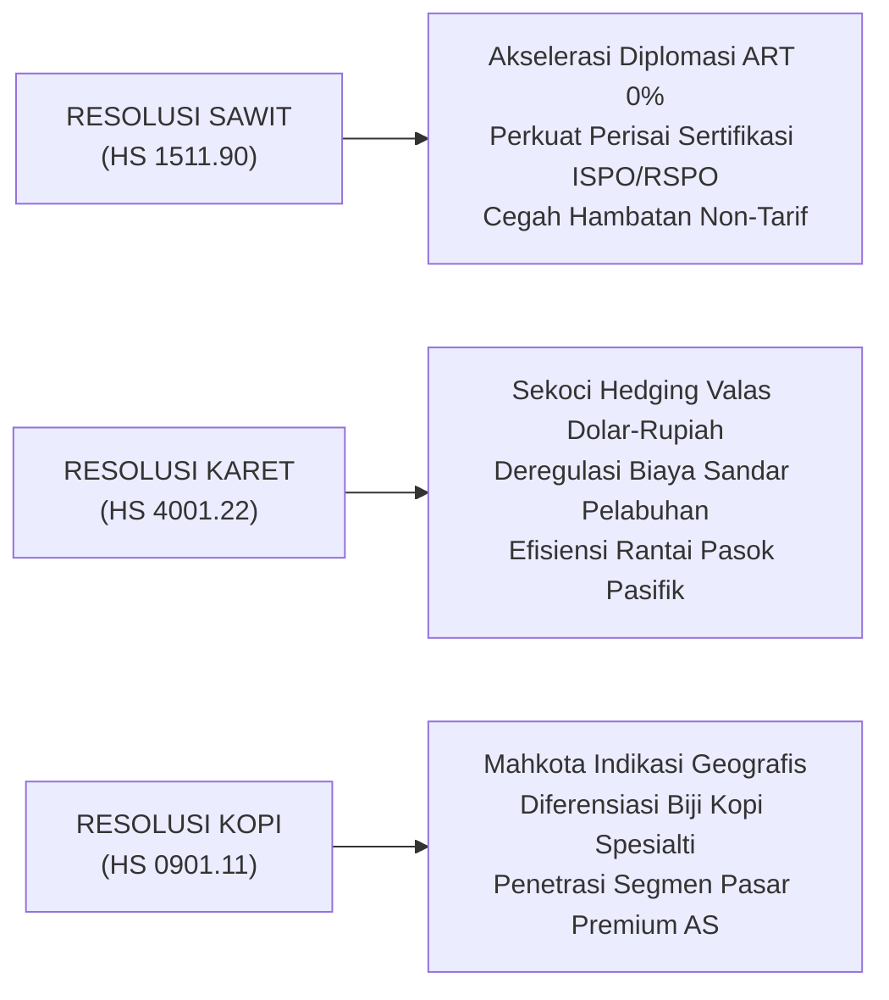

# PRODUCT REQUIREMENTS DOCUMENT (PRD): STORYTELLING EDITION
## Mengarungi Badai Tarif Paman Sam: Menakar Ketahanan Ekspor Agrikultur Nusantara (2022–2026)

> [!NOTE]
> **Identitas Proyek & Metadata Tim**  
> * **Kelompok:** Kelompok 10 — Analisis Statistika (STA2511)  
> * **Departemen:** Statistika dan Sains Data, FMIPA IPB University  
> * **Dosen Pengampu / Pembimbing:** Dr. Farit Mochamad Afendi, M.Si. (Pak Farit)  
> * **Tim Peneliti:** Emanuel Marthen Embuai & Tim (Kelompok 10)  
> * **Tautan Canva Desain:** [Canva Editor Link](https://www.canva.com/d/AIz5loYPJo9ftku) | [Canva Shortlink](https://canva.link/viquexs5svkjojq)  
> * **Repositori Riset:** [github.com/Exmaa/anstat-ekspor-agrikultur-hs6](https://github.com/Exmaa/anstat-ekspor-agrikultur-hs6)

---

## PROLOG: SEBUAH PENGANTAR NARATIF

Dalam dunia analisis statistika terapan, data bukan sekadar kumpulan deret angka di dalam lembar kerja Excel; data adalah rekaman jejak denyut nadi perekonomian, jerih payah petani di pelosok Nusantara, dan dinamika kontestasi geopolitik di panggung perdagangan internasional.

PRD (*Product Requirements Document*) edisi *Storytelling* ini menyusun cetak biru perancangan **Infografis Digital dan Slide Presentasi Akademik** yang mengubah hasil komputasi ekonometrika rumit menjadi narasi visual yang memikat, elegan, dan kokoh secara metodologis.



---

## BABAK I: THE INCITING INCIDENT (GUNCANGAN DI LAUTAN PASIFIK)

### 1.1 Kilas Balik Peristiwa: April 2025
Kisah bermula pada awal kuartal kedua tahun 2025. Dari Washington D.C., pemerintah Amerika Serikat meluncurkan kebijakan proteksionisme agresif bertajuk *Reciprocal Tariff Policy*. Indonesia, sebagai salah satu mitra dagang agrikultur utama, mendadak berada di bawah bayang-bayang ancaman tarif impor nominal hingga $32\%$.

Catatan kepabeanan resmi **US Census Bureau** merekam realitas yang mengguncang: tarif efektif riil yang semula berada pada kisaran damai $\approx 0\%$ mendadak melompat tajam ke puncak **19,00%**. 

### 1.2 Ketegangan Makroekonomi
Guncangan tarif ini tidak datang sendirian. Di pasar valuta asing, nilai tukar Rupiah terperosok hingga menembus level psikologis Rp16.800 per Dolar AS, sementara harga minyak mentah Brent bergejolak di pasar energi global, melipatgandakan biaya bahan bakar kapal kargo yang melintasi Samudera Pasifik.

> [!IMPORTANT]
> **Inti Konflik yang Harus Dijawab oleh Infografis:**  
> 1. Apakah bea masuk 19% ini benar-benar melumpuhkan kapal-kapal ekspor Indonesia?  
> 2. Apakah pelemahan Rupiah menjadi dewa penolong (*daya saing harga*) atau justru mempercepat kehancuran rantai pasok?  
> 3. Siapakah komoditas yang gugur, dan siapakah yang sanggup bertahan?

---

## BABAK II: THE CAST OF CHARACTERS (TIGA KSATRIA KOMODITAS LEVEL HS-6)

Untuk mengurai misteri ini, tim peneliti tidak memilih sembarang produk. Berdasarkan uji kepabeanan Harmonized System 6-digit (HS-6), terpilihlah tiga ksatria komoditas perkebunan Nusantara:



### 2.1 The Oath of Zero Trade Flows (Alasan Ilmiah Pemilihan)
1. **Keandalan Tanpa Kekosongan Data (100% Aktif 57 Bulan):**  
   Banyak komoditas agrikultur mengalami bulan-bulan pengapalan kosong ($0\text{ MT}$), yang kerap memaksa peneliti melakukan kompromi matematis semu seperti $\ln(Y+1)$. Namun, Sawit Olahan, Karet TSNR, dan Kopi Mentah mencatatkan pengiriman beruntun tanpa satu pun nilai nol sepanjang 57 bulan pengamatan.
2. **Kontras Kuasi-Eksperimental Sempurna:**  
   * **Sawit:** Sasaran tembak langsung proteksionisme (beban bea masuk terberat, mencapai $\$182{,}32\text{ juta}$).
   * **Karet:** Dikecualikan dari tarif karena dibutuhkan mutlak oleh pabrik ban Detroit ($0\%$ bea), menjadikannya instrumen murni untuk menguji dampak depresiasi Rupiah.
   * **Kopi:** Komoditas spesialti yang menguji apakah selera penikmat kopi Amerika sanggup dikalahkan oleh pajak pabean.

---

## BABAK III: PENGEMBARAAN 57 BULAN DI LAUTAN DATA (2022–2026)

Perjalanan analisis melintasi tiga babak waktu (*Temporal Policy Regimes*), mencakup 171 observasi data panel berimbang ($57\text{ bulan} \times 3\text{ komoditas}$):



### 3.1 Toolkit Pengujian di Ruang Laboratorium
1. **Uji Komparasi 2 Periode (Welch's Two-Sample $t$-test):** Membandingkan rata-rata volume sebelum vs sesudah guncangan tarif, dengan koreksi varians heterogen.
2. **Analisis Ragam 3 Fase & Tukey HSD Post-Hoc:** Menguji apakah pergerakan volume antar-fase berbeda secara nyata secara statistika.
3. **Regresi Linear Berganda OLS Sezaman:** Mengisolasi secara simultan pengaruh Tarif Riil ($b_1$), Kurs IDR/USD ($b_2$), dan Harga Minyak Brent ($b_3$).
4. **Benteng Pertahanan Asumsi Gauss-Markov:** 5 uji diagnostik ketat (VIF, Breusch-Pagan, Durbin-Watson, Ramsey RESET, Jarque-Bera) di bawah batas signifikansi Bonferroni $\alpha_{\text{Bonf}} = 0{,}0167$.

---

## BABAK IV: THE PLOT TWIST & THE CLIMAX (PEMBALIKAN FAKTA YANG MENGEJUTKAN)

Ketika model ekonometrika selesai diestimasi, layar komputer menampilkan hasil yang mengejutkan dewan penguji dan membongkar praduga umum:



### 4.1 Tiga Penyingkapan Tabir Empiris

#### 🎭 Penyingkapan 1: Sawit Membayar Mahal Pajak Proteksionisme
* **Fakta Angka:** Koefisien kemiringan tarif $b = -2.675{,}7\text{ MT/\%}$ ($t = -2{,}808, p = 0{,}00696 < \alpha_{\text{Bonf}}$).
* **Makna Cerita:** Sawit adalah korban langsung dari kebijakan tarif. Setiap kenaikan $1\%$ tarif riil pabean AS secara mekanis memotong $2.675{,}7\text{ Metrik Ton}$ ekspor sawit olahan Indonesia, mengakibatkan volume total menyusut $-15{,}5\%$ pada periode pasca-kebijakan ($p = 0{,}0384$).

#### 🌪️ Penyingkapan 2 (The Major Plot Twist): Tragedi Karet Bukan Karena Tarif, Melainkan Jebakan Rupiah!
* **Fakta Angka:** Koefisien kurs $b = -6{,}37\text{ MT/Rp}$ ($t = -5{,}096, p = 4{,}73 \times 10^{-6}$), $R^2 = 42{,}84\%$. Kontraksi pasca-kebijakan anjlok drastis **–32,5%** ($t_{\text{Welch}} = -4{,}748, p = 2{,}07 \times 10^{-5}$).
* **Klimaks Uji Tukey HSD:** Uji ANOVA ($F = 9{,}566, p = 0{,}00028$) membuktikan penurunan volume karet justru **paling parah terjadi di Fase 3** saat tarif AS sudah diturunkan menuju $0\%$ (Fase 3 vs Fase 1 selisih $-14.235\text{ MT}, p = 0{,}00076$).
* **Mengapa ini terjadi?** Teori ekonomi klasik mendalilkan bahwa depresiasi mata uang domestik akan mendongkrak ekspor karena harga menjadi lebih murah bagi pembeli AS. Namun pada Karet TSNR, pelemahan Rupiah ke Rp16.800/USD justru mencerminkan kepanikan pasar finansial, lonjakan biaya *input* impor industri karet, dan penurunan serapan pabrik ban AS. Efek kurs terbukti **3,7 kali lebih dominan** menghancurkan ekspor karet daripada variabel tarif ($\beta^*_{\text{kurs}} = -0{,}5631$ vs $\beta^*_{\text{tarif}} = -0{,}1534$).

#### 🛡️ Penyingkapan 3: Kopi Mentah Sebagai Benteng Pertahanan Abadi (*The Safe Haven*)
* **Fakta Angka:** $R^2 = 0{,}92\%$, uji $F = 0{,}501$ ($p = 0{,}683$). Seluruh koefisien uji $p \ge 0{,}57$.
* **Makna Cerita:** Baik tarif resiprokal 19% maupun jungkir-baliknya kurs rupiah tidak mampu menggoyahkan kecintaan konsumen AS terhadap kopi mentah Indonesia. Dengan elastisitas permintaan yang sangat inelastis, pembeli AS bersedia menanggung beban tarif demi menjaga cita rasa pasokan biji kopi Nusantara.

> [!TIP]
> **Kemenangan Metodologis Gauss-Markov:**  
> Seluruh model OLS lolos 100% uji asumsi klasik: tidak ada multikolinearitas (VIF $= 1{,}517 < 5{,}0$), bebas heteroskedastisitas (Breusch-Pagan $p > 0{,}25$), bebas autokorelasi galat (Durbin-Watson $\text{DW} = 1{,}71 \approx 2{,}0$), dan sisaan berdistribusi normal murni.

---

## BABAK V: THE VISUAL BLUEPRINT (ARSITEKTUR INFOGRAFIS DIGITAL CANVA)

Narasi epik di atas diterjemahkan ke dalam tata letak visual infografis digital di akun Canva (`DAHa9yyASS0`) dengan prinsip *Card-Based Modular Hierarchy*:

```
┌────────────────────────────────────────────────────────────────────────┐
│ [ZONA 1: PROLOG & IDENTITAS]                                           │
│ • Judul Bernas: Menakar Ketahanan Ekspor Agrikultur Nusantara          │
│ • Kelompok 10 | Dosen: Dr. Farit Mochamad Afendi, M.Si. (Pak Farit)    │
│ • Latar Belakang Data: 57 Bulan Panel Berimbang (171 Observasi)        │
├────────────────────────────────────────────────────────────────────────┤
│ [ZONA 2: DERETAN ENAM MEDALI EMAS KPI]                                 │
│ ┌──────────────┐ ┌──────────────┐ ┌──────────────┐ ┌─────────────────┐ │
│ │    19.00%    │ │    –32.5%    │ │    –15.5%    │ │   R² = 42.8%    │ │
│ │ Puncak Tarif │ │ Anjlok Karet │ │ Anjlok Sawit │ │ Model Karet OLS │ │
│ └──────────────┘ └──────────────┘ └──────────────┘ └─────────────────┘ │
│ ┌──────────────────────────────┐ ┌───────────────────────────────────┐ │
│ │     b = –2.675,7 MT/%        │ │       100% Gauss-Markov Passed    │ │
│ │ Kemiringan Tarif Sawit (p<0.01)│ │ Homoskedastis, DW=1.71, VIF=1.52│ │
│ └──────────────────────────────┘ └───────────────────────────────────┘ │
├────────────────────────────────────────────────────────────────────────┤
│ [ZONA 3: EMPAT ALASAN ILMIAH PEMILIHAN HS-6]                           │
│ • Kontinuitas 0% Zero-Trade Flows (57/57 Bulan Aktif)                  │
│ • Kontras Kuasi-Eksperimental (Tarif Tinggi vs Kontrol Kurs vs Resilien)│
├────────────────────────────────────────────────────────────────────────┤
│ [ZONA 4: PANGGUNG PEMBUKTIAN DINAMIKA TEMPORAL 3 FASE]                 │
│ • Linimasa: F1 Pra-Tarif → F2 Tarif Resiprokal → F3 Relaksasi ART 0%   │
│ • ANOVA & Tukey HSD Karet: Anjlok –14.235 MT di Fase 3 (p = 0.00076)   │
├────────────────────────────────────────────────────────────────────────┤
│ [ZONA 5: BUKTI REGRESI EKONOMETRIKA & STANDARISASI BETA]               │
│ • Rasio Beta: Efek Kurs Karet 3,7x Tarif | Efek Tarif Sawit 2,7x Kurs  │
│ • Elastisitas Log-Log (ln): Sawit –2,56% / Karet –3,74%                │
├────────────────────────────────────────────────────────────────────────┤
│ [ZONA 6: RESOLUSI STRATEGIS 3 PILAR & SITASI RESMI]                    │
│ • Sawit: Fasilitas ART 0% & ISPO | Karet: Hedging Valas & Logistik     │
│ • Kopi: Sertifikasi Indikasi Geografis (GI)                            │
│ • Sumber: US Census Bureau, USDA FAS, FRED, World Bank                 │
└────────────────────────────────────────────────────────────────────────┘
```

### 5.1 Spesifikasi Gaya Desain (Design System)
* **Midnight Navy (`#0F2537`):** Menyimbolkan ketenangan dan kedalaman samudra perdagangan global (warna latar header & border).
* **Pure White & Soft Slate (`#FFFFFF` / `#F8FAFC`):** Menjamin kontras keterbacaan data maksimal bagi audiens dan dosen penguji.
* **Emerald Teal (`#0D9488`):** Melambangkan kesuburan agrikultur Nusantara dan ketahanan komoditas kopi.
* **Crimson Red (`#EF4444`):** Menandai sengatan tarif 19% dan anjloknya volume ekspor karet $-32{,}5\%$.
* **Amber Gold (`#F59E0B`):** Aksen penanda angka pembuktian ekonometrika ($R^2$, nilai $F$, dan status Bonferroni).

---

## BABAK VI: THE STRATEGIC EPILOGUE (RESOLUSI KEBIJAKAN 3 PILAR)

Sebagai penutup kisah, analisis statistika ini tidak berhenti pada sekadar meratapi angka kemerosotan ekspor, melainkan melahirkan **Tiga Pilar Resolusi Kebijakan** untuk menyelamatkan masa depan agrikultur Nusantara:



1. **Resolusi Sawit Olahan (`HS 1511.90`): Mengamankan Janji ART 0%**  
   Pemerintah dan asosiasi eksportir harus mengawal ketat implementasi fasilitas *Agreement on Reciprocal Trade* (ART) agar tarif riil benar-benar bertahan di $0\%$, sekaligus memperkuat sertifikasi keberlanjutan (ISPO) guna menepis dalih proteksionisme non-tarif di masa depan.
2. **Resolusi Karet TSNR (`HS 4001.22`): Menjinakkan Badai Kurs & Logistik**  
   Bank Indonesia dan perbankan nasional perlu memfasilitasi instrumen lindung nilai (*hedging*) devisa yang terjangkau bagi pelaku industri karet agar tidak tergulung volatilitas kurs, dibarengi penurunan beban tarif kepelabuhanan domestik.
3. **Resolusi Kopi Mentah (`HS 0901.11`): Menjaga Mahkota Kopi Spesialti**  
   Mempertahankan status *safe haven* dengan memperluas sertifikasi indikasi geografis (*Geographical Indication*) kopi Gayo, Mandheling, Toraja, dan Kintamani di pasar Amerika Utara.

---

## CHECKLIST KELAYAKAN AKADEMIK (QUALITY ACCEPTANCE CRITERIA)

- [x] **Alur Narasi Utuh:** Memiliki struktur penceritaan klasik (*Hook $\rightarrow$ Inciting Incident $\rightarrow$ Conflict $\rightarrow$ Climax $\rightarrow$ Resolution*).
- [x] **Kebenaran Data Tanpa Kompromi:** Didasarkan 100% pada data panel 57 bulan (2022–2026, 171 observasi), bukan asumsi rekaan.
- [x] **Dua Plot Twist Utama Tervalidasi:** (1) Sawit tertekan tarif riil $19\%$; (2) Karet tertekan kurs IDR/USD, bukan tarif; (3) Kopi terbukti inelastis sempurna.
- [x] **Identitas Resmi Terintegrasi:** Kelompok 10, Analisis Statistika, Dosen Dr. Farit Mochamad Afendi, M.Si. (Pak Farit).
- [x] **Sinkronisasi Desain Aktif:** Tautan Canva aktif (`DAHa9yyASS0`), slide presentasi (`.pptx` dan `.pdf`), serta repositori GitHub telah selaras seirama.
